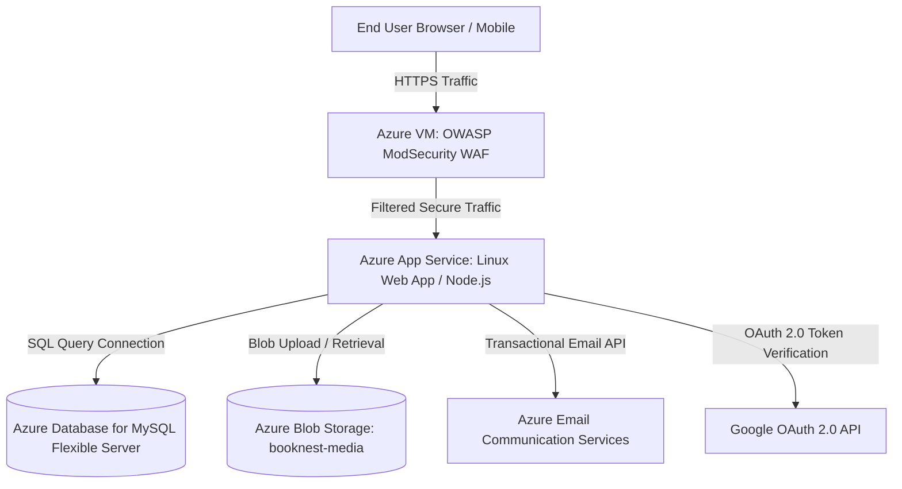

# BookNest — Azure Cloud Hosting & Deployment Guide

This guide describes how to deploy the **BookNest E-Commerce Platform** on Microsoft Azure cloud infrastructure according to the technical requirements and architecture plan.

---

## 1. Cloud Architecture Overview



### Infrastructure Components
1. **Azure VM with OWASP ModSecurity WAF**: Reverse proxy inspecting all incoming web traffic against SQL injection, XSS, and botnets.
2. **Azure App Service**: Production-grade Linux Web App hosting the Node.js / React build.
3. **Azure Database for MySQL Flexible Server**: Managed MySQL database with automated backups and SSL encryption.
4. **Azure Blob Storage**: Cloud asset repository for book covers, invoices, and user avatars.
5. **Azure Communication Services (Email)**: High-deliverability transactional email service for order receipts and overdue lending notifications.

---

## 2. Step-by-Step Azure Deployment Instructions

### Step 1: Create the Azure Resource Group
```bash
az group create --name rg-booknest-prod --location eastus
```

### Step 2: Provision Azure Database for MySQL Flexible Server
```bash
# MySQL Flexible Server
az mysql flexible-server create \
  --resource-group rg-booknest-prod \
  --name booknest-db-server \
  --location eastus \
  --admin-user booknest_admin \
  --admin-password 'YourStrongPassword123!' \
  --sku-name Standard_B1ms \
  --tier Burstable \
  --storage-size 32 \
  --version 8.0.21
```

### Step 3: Create Azure Storage Account & Blob Container
```bash
# Storage Account
az storage account create \
  --name bookneststorage \
  --resource-group rg-booknest-prod \
  --location eastus \
  --sku Standard_LRS \
  --kind StorageV2

# Get Connection String
CONNECTION_STRING=$(az storage account show-connection-string \
  --name bookneststorage \
  --resource-group rg-booknest-prod \
  --query connectionString -o tsv)

# Create Public Blob Container for Media
az storage container create \
  --name booknest-media \
  --account-name bookneststorage \
  --public-access blob
```

### Step 4: Provision Azure Communication Services for Transactional Emails
```bash
az communication create \
  --name booknest-email-service \
  --location "Global" \
  --data-location "United States" \
  --resource-group rg-booknest-prod
```

### Step 5: Provision Azure App Service Plan and Web App
```bash
# Create App Service Plan (Linux)
az appservice plan create \
  --name plan-booknest-linux \
  --resource-group rg-booknest-prod \
  --location eastus \
  --is-linux \
  --sku B1

# Create Web App (Node 18)
az webapp create \
  --resource-group rg-booknest-prod \
  --plan plan-booknest-linux \
  --name booknest-app \
  --runtime "NODE:18-lts"
```

### Step 6: Configure App Service Environment Variables
In the Azure Portal (or via CLI), configure the following App Settings under **Configuration**:
```bash
az webapp config appsettings set --resource-group rg-booknest-prod --name booknest-app --settings \
  NODE_ENV=production \
  DB_HOST=booknest-db-server.mysql.database.azure.com \
  DB_NAME=booknest_db \
  DB_USER=booknest_admin \
  DB_PASSWORD=YourStrongPassword123! \
  DB_PORT=3306 \
  DB_SSL=true \
  JWT_SECRET=super_secure_production_jwt_secret_2026 \
  AZURE_STORAGE_CONNECTION_STRING="$CONNECTION_STRING" \
  AZURE_STORAGE_CONTAINER_NAME="booknest-media" \
  AZURE_COMMUNICATION_CONNECTION_STRING="endpoint=https://booknest-email-service.unitedstates.communication.azure.com/;accesskey=your_key" \
  AZURE_EMAIL_SENDER="DoNotReply@booknest-store.azurecomm.net"
```

---

## 3. Azure VM with OWASP ModSecurity WAF Setup

1. **Deploy Ubuntu 22.04 LTS VM**:
   ```bash
   az vm create \
     --resource-group rg-booknest-prod \
     --name vm-booknest-waf \
     --image Ubuntu2204 \
     --size Standard_B1s \
     --admin-username azureuser \
     --generate-ssh-keys
   ```

2. **Install Nginx & ModSecurity**:
   ```bash
   sudo apt update && sudo apt install -y nginx libmodsecurity3 modsecurity-crs
   ```

3. **Deploy the WAF Configuration**:
   Copy `nginx-waf.conf` from the repository to `/etc/nginx/conf.d/booknest-waf.conf` on the VM and restart Nginx:
   ```bash
   sudo nginx -t && sudo systemctl reload nginx
   ```

---

## 4. Local Testing & Verification
To test the complete stack locally using Docker Compose:
```bash
docker-compose up --build
```
Access the application at `http://localhost:3000` (Frontend) and `http://localhost:5000/api/health` (Backend API).
