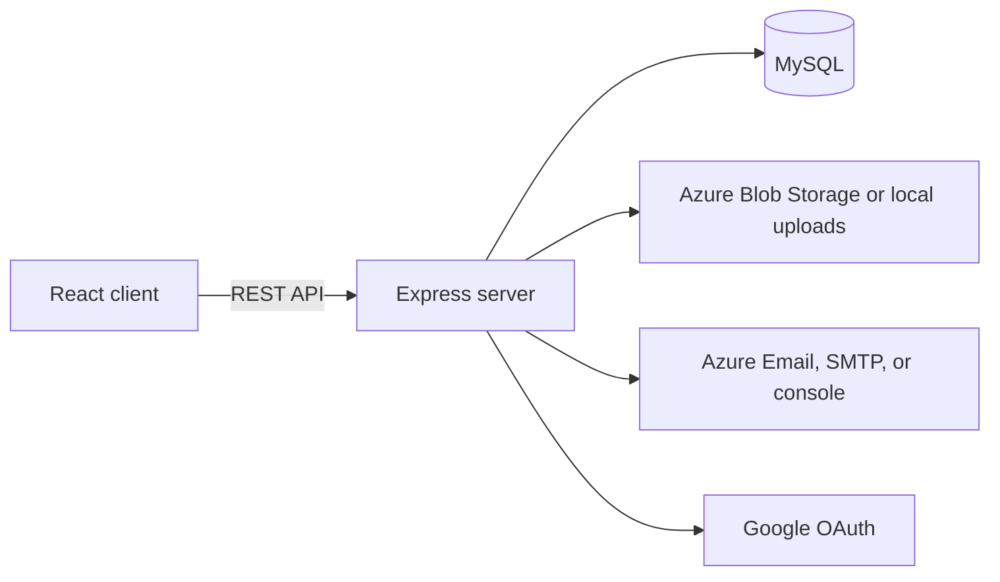

# BookNest

BookNest is a full-stack e-commerce and book-lending platform. Customers can browse and review books, purchase or borrow titles, manage their profiles, and track orders. Administrators can manage inventory, orders, lending requests, and customer notifications from a dedicated dashboard.

## Features

### Customer experience

- Browse featured books and filter the catalogue by category
- View book details, ratings, reviews, pricing, and availability
- Add books to a cart and complete guest or authenticated checkout
- Request books for lending and manage returns
- Track orders using an order ID and email address
- View profile details, order history, and active lendings
- Sign in with Google only; browse, keep a local cart and purchase as a guest

### Administration

- View sales, order, lending, customer, and inventory statistics
- Create, update, and delete books with cover image uploads
- Manage order fulfilment statuses
- Approve, reject, and complete lending requests
- Send customer email notifications

### Platform capabilities

- MySQL-backed HttpOnly cookie sessions and server-enforced roles
- MySQL persistence through Sequelize
- Azure Blob Storage with a local upload fallback
- Azure Communication Services email with SMTP and console fallbacks
- Scheduled overdue lending notifications
- Helmet security headers, CORS, rate limiting, and an optional Nginx ModSecurity WAF
- Docker Compose and Microsoft Azure deployment support

## Technology Stack

| Layer | Technologies |
| --- | --- |
| Frontend | React 18, Vite, React Router, Axios, Lucide React |
| Backend | Node.js, Express, Sequelize, Google Identity Services, server sessions |
| Database | MySQL 8 |
| Cloud services | Azure App Service, Blob Storage, Communication Services, Azure Database for MySQL |
| Infrastructure | Docker, Docker Compose, Nginx, ModSecurity |

## Architecture



## Getting Started

### Prerequisites

- Node.js 18 or newer
- npm
- MySQL 8 or Docker Desktop

### Option 1: Docker Compose

Start the complete application and MySQL database:

```bash
docker compose up --build
```

Open the following services:

- Frontend: <http://localhost:3000>
- API health check: <http://localhost:5000/api/health>

The Compose stack is for local HTTP development. Supply `SESSION_SECRET` and `GOOGLE_CLIENT_ID` in your shell or root `.env` before running it. Production requires HTTPS, production mode, private database credentials and correct trusted proxy settings. See [Authentication Decisions](AUTHENTICATION.md).

### Option 2: Local Development

1. Install all dependencies from the repository root:

   ```bash
   npm run install:all
   ```

2. Create a MySQL database:

   ```sql
   CREATE DATABASE booknest_db;
   ```

3. Create the backend environment file:

   ```bash
   cp backend/.env.example backend/.env
   ```

   On Windows PowerShell, use:

   ```powershell
   Copy-Item backend/.env.example backend/.env
   ```

4. Update `backend/.env` with your MySQL credentials and a random `SESSION_SECRET` of at least 32 characters.

5. Configure a Google Web application OAuth client and create `frontend/.env`:

   ```env
   VITE_GOOGLE_CLIENT_ID=your-google-client-id.apps.googleusercontent.com
   ```

   Set the same client ID as `GOOGLE_CLIENT_ID` in `backend/.env`. Register the exact browser origin with Google and in `APP_ORIGINS`. See [Google setup](AUTHENTICATION.md#google-setup).

6. Start the frontend and backend development servers:

   ```bash
   npm run dev
   ```

7. Open <http://localhost:5173>. The Vite development server proxies `/api` and `/uploads` requests to <http://localhost:5000>.

On backend startup, Sequelize creates missing tables, including the session table. Run `npm --prefix backend run seed` explicitly to add catalogue data. No accounts or reviews are seeded.

## Environment Variables

The complete backend template is available at `backend/.env.example`.

| Variable | Required | Purpose |
| --- | --- | --- |
| `PORT` | No | Backend port; defaults to `5000` |
| `NODE_ENV` | No | Runtime environment, such as `development` or `production` |
| `SESSION_SECRET` | Production | Random cookie-signing secret, at least 32 characters |
| `APP_ORIGINS` | Deployment | Exact allowed browser origins for CORS and state-changing API requests |
| `GOOGLE_CLIENT_ID` | For Google sign-in | Server-side Google token audience |
| `DB_HOST` | No | MySQL host; defaults to `localhost` |
| `DB_PORT` | No | MySQL port; defaults to `3306` |
| `DB_NAME` | No | Database name; defaults to `booknest_db` |
| `DB_USER` | No | Database user; defaults to `root` |
| `DB_PASSWORD` | No | Database password |
| `DB_SSL` | No | Set to `true` for managed MySQL SSL |
| `AZURE_STORAGE_CONNECTION_STRING` | No | Enables Azure Blob Storage uploads |
| `AZURE_STORAGE_CONTAINER_NAME` | No | Blob container; defaults to `booknest-media` |
| `AZURE_COMMUNICATION_CONNECTION_STRING` | No | Enables Azure Communication Services email |
| `AZURE_EMAIL_SENDER` | No | Verified Azure sender address |
| `SMTP_HOST`, `SMTP_PORT`, `SMTP_USER`, `SMTP_PASS` | No | SMTP fallback configuration |

Without Azure Storage configuration, uploaded files are saved under `backend/uploads`. Without Azure email or SMTP credentials, email delivery is logged to the backend console for development.

## Authentication

Google is the only sign-in method. Demo accounts, role switching and password login are not available. New users are customers. After signing in through Google, a trusted operator can grant administrator access:

```bash
npm --prefix backend run admin:promote -- your-google-email@example.com
```

Guests can browse, use a local cart and purchase books. Borrowing, reviews, saved carts and account history require Google sign-in. Guest tracking requires an order ID and checkout email and excludes private contact/delivery details. See [Authentication Decisions](AUTHENTICATION.md) for the full access matrix, existing-data policy and deployment requirements.

## Available Scripts

Run these commands from the repository root:

| Command | Description |
| --- | --- |
| `npm run dev` | Start the backend and Vite development server together |
| `npm run dev:backend` | Start the backend with Nodemon |
| `npm run dev:frontend` | Start only the Vite development server |
| `npm run build` | Install workspace dependencies and build the frontend |
| `npm start` | Start the backend in production mode |
| `npm run install:all` | Install root, backend, and frontend dependencies |

To add missing catalogue records without deleting existing data, run:

```bash
npm --prefix backend run seed
```

The seed command is repeatable and creates no users or reviews. The separate SQL schema import remains destructive and must not be used to migrate an existing database.

## API Overview

| Base route | Responsibility |
| --- | --- |
| `/api/auth` | Google authentication, session logout and customer profiles |
| `/api/books` | Catalogue, categories, book details, and reviews |
| `/api/cart` | Cart item management and synchronization |
| `/api/orders` | Checkout, order history, and order tracking |
| `/api/lending` | Lending requests, history, and returns |
| `/api/admin` | Protected administration operations |
| `/api/health` | Service health check |

## Project Structure

```text
.
|-- backend/
|   |-- database/          # MySQL schema
|   |-- src/
|   |   |-- config/        # Database configuration
|   |   |-- controllers/   # Request handlers
|   |   |-- middleware/    # Authentication and authorization
|   |   |-- models/        # Sequelize models and relationships
|   |   |-- routes/        # REST API routes
|   |   |-- seeders/       # Catalogue data only
|   |   `-- services/      # Storage, email, and scheduled jobs
|   `-- uploads/           # Local media fallback
|-- frontend/
|   `-- src/
|       |-- components/    # Shared interface components
|       |-- context/       # Authentication and cart state
|       |-- pages/         # Customer, profile, tracking, and admin views
|       |-- services/      # Axios API client
|       `-- utils/         # Frontend utilities
|-- docker-compose.yml
|-- nginx-waf.conf
`-- AZURE_DEPLOYMENT_GUIDE.md
```

## Production Build

Build the React application and start the Express server:

```bash
npm run build
npm start
```

Express serves the generated `frontend/dist` directory and handles client-side route fallbacks. Ensure the production environment variables and database are configured before starting the server.

For Azure infrastructure and WAF setup, see [AZURE_DEPLOYMENT_GUIDE.md](AZURE_DEPLOYMENT_GUIDE.md).

## License

This project is distributed under the ISC license as declared in the package metadata.